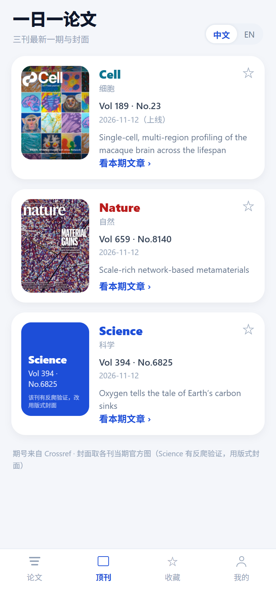
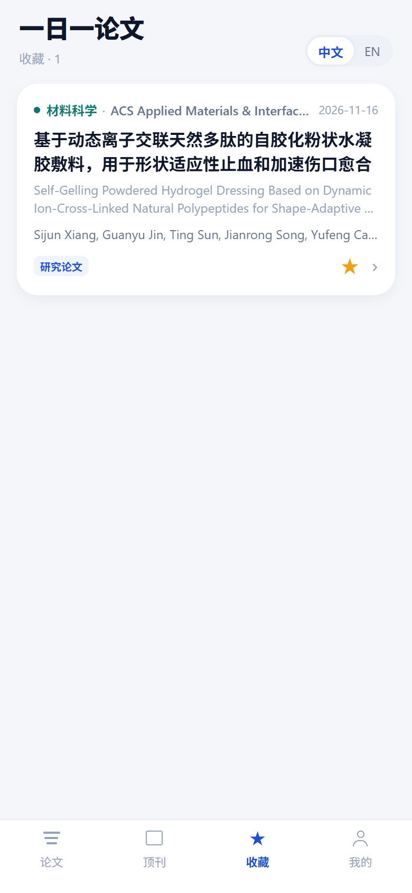
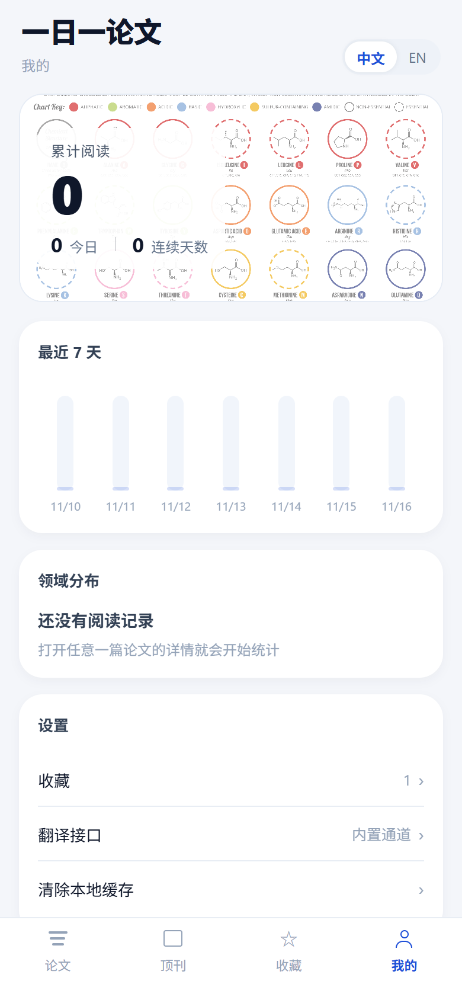

# PaperDaily

[中文](README.md) | **English**

[](https://github.com/junjunlab/paperDaily/actions/workflows/build.yml)
[](https://github.com/junjunlab/paperDaily/releases/latest)
[](https://github.com/junjunlab/paperDaily/releases)
[](https://github.com/junjunlab/paperDaily/releases/latest)
[](https://github.com/junjunlab/paperDaily/stargazers)


A reading app that does exactly one thing: **every day, put the newest papers from Cell, Nature, Science and ~160 other top journals in front of you — in Chinese, filtered to your field.** Native iOS / Android, built with Expo (React Native + TypeScript) from one codebase. No backend, no account, no ICP filing.

## Screens

| Papers (field / date range / daily picks) | Journals (current issue + cover) |
|---|---|
|  |  |

| Saved (what you starred) | Me (local reading stats + settings) |
|---|---|
|  |  |

> Screenshots are captured from the React Native Web build in headless Chrome at 390×844 — same rendering pipeline as the native app, used to verify layout and data flow. Scrolling and native controls feel better on device.

## Quick start

```bash
npm install

# Preview on a phone (easiest): install Expo Go, scan the QR code
npx expo start

# Emulators (iOS needs macOS + Xcode)
npm run android
npm run ios
```

> Not here to read code? Grab a build from [**Releases**](https://github.com/junjunlab/paperDaily/releases/latest): `PaperDaily.apk` installs on Android; the iOS ipa is unsigned and needs self-signing (see below).

## Features

| Tab | What's inside |
|---|---|
| **Papers** | 9 fields + **99 sub-fields** (scored from title/abstract, so you can go from "All" to "Life Sciences › Neuroscience"); today / 3 / 7 / 30 days + custom range; journal panel with 160 curated journals (search by abbreviation or ISSN) plus full Crossref journal search; sort by newest or by impact factor; keyword search with live suggestions over the last two years; **daily picks** (3 papers chosen from impact factor and your field); a **following** strip that flags journals with new papers; pull to refresh |
| **Journals** | Current issue number, date, lead article and cover for Cell / Nature / Science; tap through to the full table of contents; star a journal to get a **new** badge when the next issue lands |
| **Saved** | Star any paper from its card; the whole record (abstract included) is stored on device and readable offline |
| **Me** | Total papers read, today, streak, last 7 days, field distribution; translation endpoint settings; clear cache |

Bilingual UI with one tap. In Chinese mode titles and abstracts are **machine-translated on the fly** — the translation is shown as the title, the original is kept underneath.

## Data sources

| Purpose | Endpoint |
|---|---|
| Paper list / search / issue numbers / issue contents | `https://api.crossref.org` |
| Full journal search | `https://api.crossref.org/journals?query=` (does not support `select`; passing it returns 400) |
| Abstract fallback | Europe PMC → PubMed (NCBI eutils) → OpenAlex → Semantic Scholar → Nature page meta (10.1038 only) |
| Covers | Cell `ars.els-cdn.com`, Nature `media.springernature.com` (Science is behind Cloudflare — layout cover instead) |
| Chinese translation | `transmart.qq.com` (default) → `api.mymemory.translated.net` (fallback) → your own OpenAI-compatible endpoint |

**No backend and no domain filing required.** This is the biggest simplification compared with the original WeChat Mini Program, which needed registered request domains and an ICP filing — a native app just makes the request.

## Building on GitHub (Actions)

### Releases: push a tag

```bash
git tag v1.0.0
git push origin v1.0.0
```

`.github/workflows/release.yml` builds both platforms and attaches the packages to the Release for that tag (marked Latest). Stable download URLs afterwards:

- APK: <https://github.com/junjunlab/paperDaily/releases/latest/download/PaperDaily.apk>
- IPA: <https://github.com/junjunlab/paperDaily/releases/latest/download/PaperDaily-unsigned.ipa>

| File | Platform | Notes |
|---|---|---|
| `PaperDaily.apk` | Android 7.0+ | Install as-is; allow "install from unknown sources" the first time |
| `PaperDaily-unsigned.ipa` | iOS | **Unsigned** — sign it yourself: Sideloadly / AltStore (free Apple ID, 7-day expiry) or re-sign with a developer account |

### Every day: artifacts on master

`.github/workflows/build.yml`: **every push to master builds both platforms**, and you can also hit "Run workflow" on the Actions tab (docs-only changes are skipped). Grab the files from Actions → a run → Artifacts, kept 90 days — **signing in to GitHub is required**.

- iOS is unsigned because signing needs an Apple Developer certificate and provisioning profile, which cannot live in a public repo; use EAS Build below for an installable IPA.
- Fine for personal use, but **swap the keystore before publishing**: `android/app/build.gradle` reuses `signingConfigs.debug` for release — generate your own and point `signingConfig` at it.
- The workflow runs `expo prebuild` to generate the native projects on the fly; `android/` and `ios/` are not committed (both are gitignored).

## Building installable binaries (EAS Build)

No Android SDK or Xcode needed locally — build in the cloud:

```bash
npm i -g eas-cli
eas login
eas build:configure

eas build -p android --profile preview     # .apk, installable directly
eas build -p android                       # .aab for Google Play
eas build -p ios                           # .ipa, needs an Apple Developer account
```

The bundle id is set to `com.paperdaily.app` in `app.json` (change it to your own reverse domain). For distribution in China you can ship the APK directly, no store required.

## Known limits

- **No binary is built in this repo** — the `.apk` comes from GitHub Actions (above), the `.ipa` needs your own signing, or use EAS Build / a local toolchain.
- **Journals data comes from a background refresh** — if it fails, the app shows the issue numbers saved last time with a note in the footer; pull down to retry.
- **No real cover for Science** — the whole site sits behind a Cloudflare challenge, and cover URLs are per-issue random GUIDs that cannot be derived from the issue number.
- **Keyless translation has a daily quota** — when it runs out, translation pauses and English is shown; configure a key for something stable.
- **The publisher-abstract fallback only works on device** — Nature's pages send no CORS headers, so browser previews cannot read them; it works in the native app.
- **Field filtering loses some records** — the app fetches the newest N papers in the window and filters locally, so rare fields may end up with only a few; widen the range.
- **60 items per list** — same cap as the Mini Program, to keep rendering cheap.
- **Custom date ranges filter on publication date** — Crossref's range filter uses the ingestion date, which can differ by a few days, so records are re-checked locally against the date shown on the card.

## License

MIT
