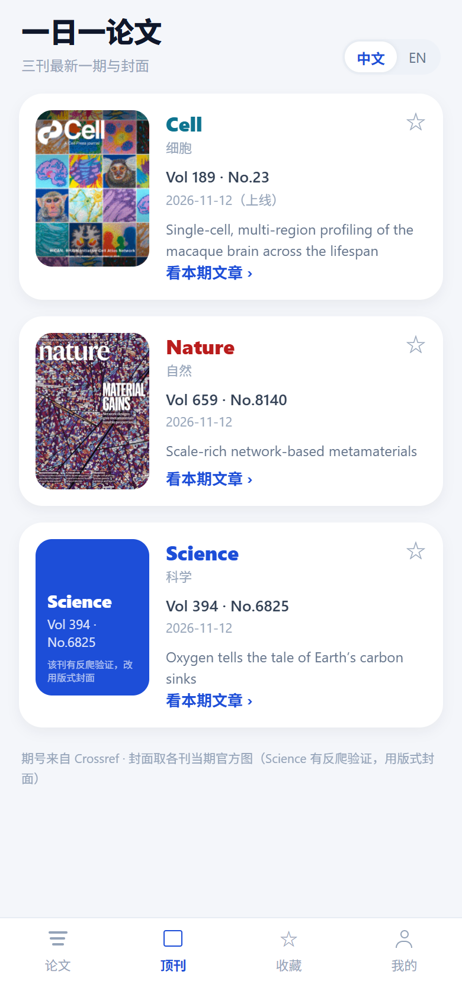
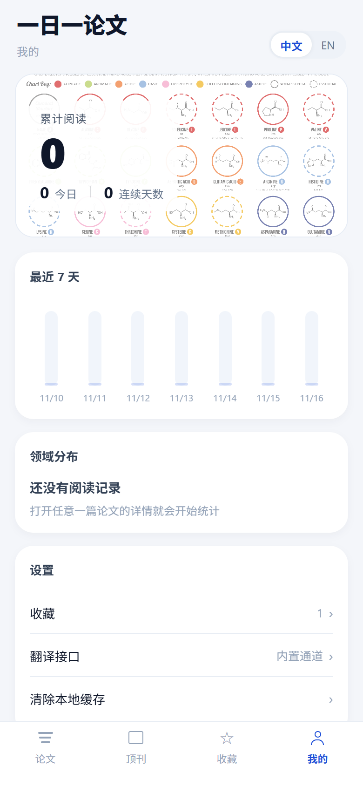

# 一日一论文 · PaperDaily

**中文** | [English](README.en.md)

一个只做一件事的科研阅读器：**每天把 Cell / Nature / Science 和一百多本顶刊的最新论文，按你的领域，用中文摆到你面前。** 原生 iOS / Android 应用，Expo（React Native + TypeScript）一套代码两端跑，没有后端、没有账号、没有备案域名。

## 界面

| 论文（领域 / 时间 / 每日精选） | 顶刊（CNS 当期期号与封面） |
|---|---|
|  |  |

| 收藏（点星标攒起来的） | 我的（本地阅读统计 + 设置） |
|---|---|
|  |  |

> 截图是 390×844 视口下用无头 Chrome 抓的 Web 渲染（React Native Web），与真机同源，用来验证排版和数据链路；真机滚动手感和原生控件更顺。

## 快速开始

```bash
npm install

# 手机预览（推荐先走这条）：手机装 Expo Go，扫终端二维码
npx expo start

# 模拟器（iOS 需 macOS + Xcode）
npm run android
npm run ios
```

> 仓库里没有编译好的 `.apk` / `.ipa`。真机预览走 Expo Go，正式安装包走 EAS Build（见下文）。

## 功能

| Tab | 内容 |
|---|---|
| **论文** | 9 个领域 + **99 个二级子领域**（按题名/摘要打分归类，可从"全部"切到"生命科学 › 神经科学"）；今天 / 3 / 7 / 30 天 + 自定义日期；期刊面板（160 本精选刊，支持简称、ISSN 搜索）+ 全库期刊检索；排序（最新 / 高影响因子）；关键词搜索（输入即联想近两年论文）；**每日精选**（按影响因子和你的领域偏好自动挑 3 篇）；**我的关注**横滑条（关注的刊有新文亮红「新」）；下拉刷新 |
| **顶刊** | Cell / Nature / Science 当期期号、日期、头条与封面，点进去看本期全部文章；每本可 ★ 关注，有新期时卡片上标「新」 |
| **收藏** | 点论文卡片右下角的 ☆ 收藏，整条记录（含摘要）存在本机，断网也能看 |
| **我的** | 累计阅读、今日、连续天数、最近 7 天柱状、领域分布；翻译接口配置；清缓存 |

中英一键切换；中文模式下论文标题与摘要会**自动机翻成中文**（标题直接显示，原文折叠在下面）。

## 数据来源

| 用途 | 接口 |
|---|---|
| 论文列表 / 搜索 / 期号 / 本期文章 | `https://api.crossref.org` |
| 期刊全库检索 | `https://api.crossref.org/journals?query=`（不支持 `select`，传了会 400） |
| 摘要补全 | Europe PMC → PubMed（NCBI eutils）→ OpenAlex → Semantic Scholar → Nature 页面 meta（仅 10.1038） |
| 封面图 | Cell `ars.els-cdn.com`、Nature `media.springernature.com`（Science 有 Cloudflare 反爬，走版式封面） |
| 中文翻译 | `transmart.qq.com`（默认）→ `api.mymemory.translated.net`（兜底）→ 自备 OpenAI 兼容接口 |

**没有后端，也不需要备案域名** —— 这是 App 相对小程序最大的一处简化：小程序要配 request 合法域名、要 ICP 备案，App 直接联网即可。

## 在线构建安装包（GitHub Actions）

仓库自带 `.github/workflows/build.yml`：**推到 master 就自动构建两端**，也可以在 Actions 页面点「Run workflow」手动触发（只改 README / docs 不触发）。

| Artifact | 说明 |
|---|---|
| `PaperDaily-android-apk` | release APK，用 Expo 模板自带的 debug keystore 签名，**下载后直接安装** |
| `PaperDaily-ios-ipa-unsigned` | **未签名** IPA，需要自己签名才能装（Sideloadly / AltStore，或有开发者账号重签） |

下载：Actions → 选一次运行 → 页面底部 Artifacts（保留 90 天）。

- iOS 未签名是因为签名需要 Apple 开发者账号的证书和 provisioning profile，不能放进公开仓库；要出可直装的 ipa 走下面的 EAS Build。
- 自用够了，但**上架要换 keystore**：`android/app/build.gradle` 里 release 默认复用 `signingConfigs.debug`，请生成自己的并改 `signingConfig`。
- 构建流程是 `expo prebuild` 现生成原生工程再编译，仓库里不存 `android/` `ios/` 目录（都在 `.gitignore` 里）。

## 打正式安装包（EAS Build）

本机不需要 Android SDK / Xcode，用 Expo 云构建：

```bash
npm i -g eas-cli
eas login
eas build:configure

eas build -p android --profile preview     # .apk，可直接装
eas build -p android                       # .aab，上 Google Play
eas build -p ios                           # .ipa，需 Apple 开发者账号
```

包名已配好 `com.paperdaily.app`（在 `app.json`，换成你自己的域名倒序）。国内分发可以只出 APK 直接发，不经过商店。

## 已知边界

- **仓库里没有编译好的包**：`.apk` 由 GitHub Actions 构建（见上），`.ipa` 需要自行签名，或用 EAS Build / 本地工具链。
- **CNS 当期数据靠后台刷新**：刷新失败时先显示上次存下的期号，页脚会提示，下拉重试即可。
- **Science 没有真封面**：全站 Cloudflare 挑战，封面 URL 是每期随机 guid、无法从期号推导，只能用版式封面。
- **免密钥翻译有每日配额**：额度用尽时译文暂停、保持英文，恢复后继续；要稳定就配 Key。
- **出版社摘要兜底只在真机生效**：Nature 页面没有 CORS 头，浏览器预览拿不到，手机上正常。
- **领域筛选有取整损失**：先按时间窗拉最新 N 条再本地过滤，冷门领域可能只剩几条，放大时间范围即可。
- **列表上限 60 条**：和小程序版一致，防一次性渲染太多。
- **自定义日期按「发表日期」筛**：Crossref 的区间过滤走「收录日期」，两者会差几天，所以选完日期后本地再按卡片日期收一次。

## License

MIT
